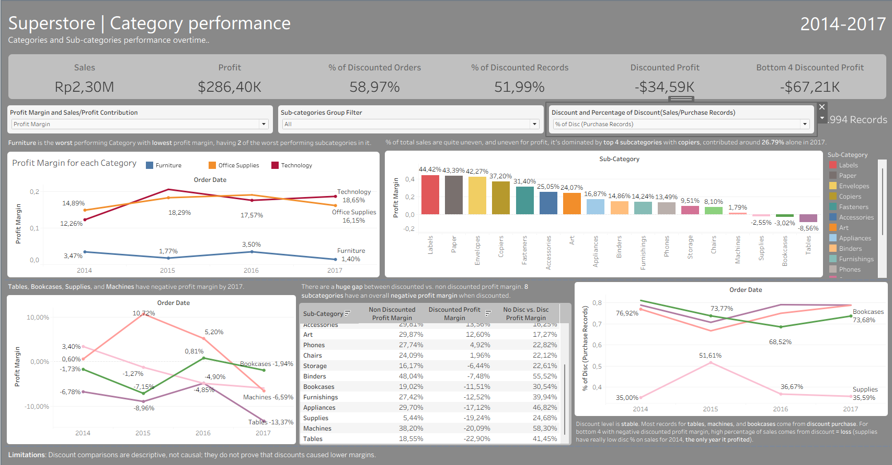

# Superstore Sales and Profitability Analysis

A MySQL and Tableau analysis of category, subcategory, and discount performance in the Sample Superstore dataset. The project focuses on how sales and profit vary across category and subcategory over time, and how discounted purchases compare with non-discounted purchases.

## Business context

**Company:** a US retailer selling Furniture, Office Supplies and Technology to Consumer, Corporate and Home Office customers.

**Dataset:** 9994 order records, Dating from 2014-2017.

**Stakeholder:** Category manager reviewing product-group performance and discount patterns.

**Business question:** Which categories and subcategories contribute to sales and profit, where are margins weakest, and what discount-related patterns should be investigated further?

## Business questions

- How do sales, profit, and profit margin vary by category and subcategory?
- How concentrated are sales and profit across product groups?
- How have category and subcategory results changed from 2014 through 2017?
- How do discounted and non-discounted records compare in profit margin and quantity?
- Which subcategories contribute to negative-profit records? Where and why are we losing money?

## Dataset

The analysis uses the [Superstore Sales dataset](https://www.kaggle.com/datasets/nayakganesh007/superstore-sales-dataset/data) CSV file. It contains 9,994 order-line records and 5,009 distinct orders from January 2014 through December 2017, across 3 categories and 17 subcategories. Fields include order id, order date, ship mode, customer name, Segment, Region, product categories, sales, quantity, discount, and profit.

Each row represents an order line. It is not necessarily a distinct order; an order can contain multiple lines for each purchased products. Check the dataset's original source and terms before redistributing the CSV.

## Tools

- **MySQL 8.0 or later** — data import, validation, and analysis using common table expressions and window functions.
- **Tableau** — interactive dashboard for category and subcategory performance, trends, and discount comparisons.

## Repository contents

```text
superstore-analysis/
├── README.md
├── images/
│   └── superstore_dashboard_preview.png
├── super_store_script.sql
└── superstore.twbx
```

## How to run

1. Use MySQL 8.0 or later.
2. Open `super_store_script.sql` and replace the example path in `LOAD DATA LOCAL INFILE` with the location of `Sample - Superstore.csv` on your computer.
3. Allow `LOAD DATA LOCAL INFILE` in both the MySQL server and client. The server setting in the script may require administrator privileges; client configuration is separate.
4. Run the SQL script from the beginning through the end.
5. Open `superstore.twbx` in Tableau. If Tableau asks you to locate the CSV, reconnect it to `Sample - Superstore.csv`.

**Reset behavior:** each full run drops and recreates the `orders` table before importing the CSV. This replaces that table's contents; the script does not drop the `superstore` database. Back up any data in `orders` that you need to keep.

## Analysis, findings, and conclusions

The SQL analysis moves from overall category and subcategory performance, looking at the whole sales and profit contribution to the total for each category and subcategory, to category and subcategory YoY trends, discount comparisons analysis, and loss-making records analysis. The findings below describe patterns in this dataset; they do not establish the causal effect that discounts are the main cause of lower margins.

### 1. Furniture has the weakest category margin

Furniture had the lowest four-year category profit margin at **2.49%**. In 2017, furniture margin was **1.40%**, compared with **16.15%** for Office Supplies and **18.65%** for Technology. Furniture's two weakest subcategories, Tables and Bookcases(2 of the worst performing subcategories), contribute to its low overall result.

Sales contribution of all three categories is pretty even, but the profit contribution is not. Furniture only contributed **6.44%** of total profit for 4 years aggregate, and **3.23%** for 2017. Technology and office supplies contribute pretty evenly at high percentage, with technology performing the best.

**Business implication:** review Furniture at the subcategory and product level to identify which items and discount patterns account for the low margin.


### 2. Sales and profit are concentrated in a few subcategories

Sales are distributed quite unevenly across all subcategories, with phones at the top contributed **14.37%** of total sales, and with the top 5 subcateogries contributing to **56.27%** of total sales for 4 years aggregate. For 2017 phones contributed **14.37%** and top 5 subcategories contributed **55.41%** of total sales.

Profits are distributed unevenly accross all subcategories. Copiers contributed **19.42%** of total profit, and the top three profit-contributing subcategories together accounted for **49.6%** of 4 years aggregate profit. For 2017 copiers contributed **26.79%** and the top three contributed **57.31%** of total profits. 

**Business implication:** monitor the business's reliance on its largest profit contributors. Protect the market position, and start to diversify or develop other subcategoies to lower the reliance.

### 3. Four sub-categories lose money by 2017**

| Sub-category | 4-year margin | 2017 margin |
|---|---|---|
| Tables | -8.56% | -13.37% |
| Bookcases | -3.02% | -1.94% |
| Supplies | -2.55% | -5.95% |
| Machines | +1.79% | -6.59% |

Across the full 4 years period, Tables (**−8.56%**), Bookcases (**−3.02%**), and Supplies (**−2.55%**) had negative aggregate profit margins. Machines had a positive margin over the full period, but its 2017 margin fell to **−6.59%**.

Monitor the weakest subcategories, and Review individual products before making assortment, product removal, discount adjustment, or pricing decisions.

### 4. Category trends differ over time

From 2014 to 2017, Furniture's profit margin fell from **3.47%** to **1.40%**. Office Supplies increased from **14.89%** to **16.15%**, while Technology increased from **12.26%** to **18.65%**. 

**Business implication:** use the year-by-year view to spot changes in category mix and margins, then investigate specific products or subcategories behind those changes.

### 4. Discounted records have lower aggregate margins in several subcategories

Discounted records account for **51.99%** of total records, and **58.97%** of total orders. Discounted records have net profit of about **−$34,590** across the dataset; in Tables, Bookcases, Supplies, and Machines combined, discounted records have net profit of about **−$67,211**.

All negative-profit records in this dataset had a discount, but some discounted records were still profitable. Across subcategories, average quantity per order line is nearly identical for discounted and non-discounted records, while profit margins differ. The largest margin gap is in Machines at **58.29 percentage points**; the smallest is in Fasteners at **11.03 percentage points**.

**Business Implication:** review the discount made, the reason of the discount, the effect, and the amount of discount.   

### 5. Discounts cut margin, not quantity 
Looking at aggregate 4 years performance in each categories, comparing the profit margin of without and with discount:

| Category | Without Discount | With Discount |
|---|---|---|
| Furniture | 22.71% | -8.17% |
| Technology | 33.96% | 2.94% |
| Office Supplies | 29.52% | -2.89% |

When discounted the profit margin lowers significantly, and even turning furniture and office supplies profit margin to negative. Also Average quantity per order is nearly the same with or without a discount.

Looking at aggregate 4 years performance in each subcategories the gap between profit margin of undiscounted and discounted orders **ranged from 11 to 58 percentage points lower**. Where eight sub-categories earn a positive margin at full price and a negative one when discounted: Appliances, Binders, Bookcases, Furnishings, Machines, Storage, Supplies and Tables. For quantity, average quantity per order is **nearly the same with or without a discount**.

**Business implication:** investigate discount levels at the product level and test pricing changes before setting discount caps or discontinuing products. The comparisons are descriptive; they do not show that discounts caused the observed margin differences.

### Discount on bottom 4 subcategories
undiscounted margin and discount range for 4 years aggregate:

| Sub-category | Full-price profit margin 4 year average | Discounts used |
|---|---|---|
| Supplies | 7.73% | always exactly 20% |
| Tables | 18.47% | 20–50% (averaging around 33-34%) |
| Bookcases | 19.55% | 15–70% (averaging around 25-31%) |
| Machines | 38.79% | 10–70% (averaging around 38-43%) |

Looking at this table, the margin will most of the time be negative when its discount is used. The higher the percentage of sales comes from discounted orders the more likely it's to become a loss. 

Years where these subcategories are performing at a loss are when their sales are mostly coming from discounted orders, or when the full-price profit couldn't offset the losses coming from discounted sales.     

**Business implication:** investigate the reason of high discounted sales percentage.

## Tableau dashboard

The dashboard provides interactive views of the main SQL analysis:
Having 3 parameter:
- **P1 — Performance:** switches between profit contribution, sales contribution, and profit margin.
- **P2 — Subcategory group:** shows all, top four, or bottom four subcategories for the selected performance measure.
- **P3 — Discount measure:** switches between average discount, discounted share of sales, and discounted share of purchase records (order lines).

The discount comparison table displays non-discounted margin, discounted margin, and their gap. The gap is calculated as **non-discounted margin minus discounted margin**; a positive value means the non-discounted margin is higher. The separate discounted-order KPI counts distinct orders with at least one discounted line.

## Recommendations

1. Review discount practices for all products, and cap discount to its baseline margin if feasible, especially for Tables, Bookcases, Supplies, and Machines subcategories.
2. Run controlled pricing tests before changing discount policies; compare both sales and profit.
3. Monitor and analyze low performing products or subcategories, while testing methods to improve and see any signal to discontinue as the last resort.
4. Track profit concentration in Copiers and the other leading subcategories, while investigating opportunities to strengthen weaker groups.

## Limitations

- **Descriptive comparisons, not causation** — product mix, customers, and timing can differ between discounted and non-discounted records. The analysis does not establish that discounts caused lower margins.
- **Order-line grain** — record-based discount share and average quantity are calculated per order line. The distinct-order KPI uses unique order IDs.
- **No cost, shipping or return data**, so it cannot tested whether operational these problems also add to the losses.
- **Limited period and sample** — findings describe the supplied Sample Superstore data for 2014–2017 and may not generalize to other businesses or periods. For example tables, bookcases, supplies and machines have only about 20–100 orders a year, so year-to-year changes are signals, not proof.

## SQL script sections

The SQL file is organized into database and table setup, data import, validation, business questions, category performance, subcategory performance, year-over-year trends, discount analysis, loss analysis, and findings, conclusions, recommendations, and limitations.

## Files

- `super_store_script.sql`, data setup, validation, analysis queries, findings, and recommendations.
- `superstore.twbx`, packaged Tableau workbook.
- `README.md`, this project overview and analysis summary.

## Dashboard
To look or explore the dashboard directly from Tableu Public you can click [here](https://public.tableau.com/views/superstore_17928658517760/Dashboard2?:language=en-US&:sid=&:redirect=auth&:display_count=n&:origin=viz_share_link), or if you can also open the **.twbx** files to look at the dashboard.

Preview of the dashboard:

